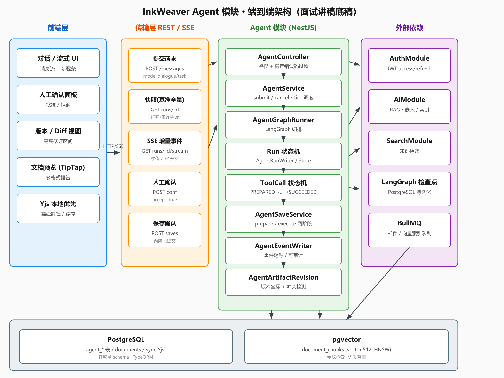
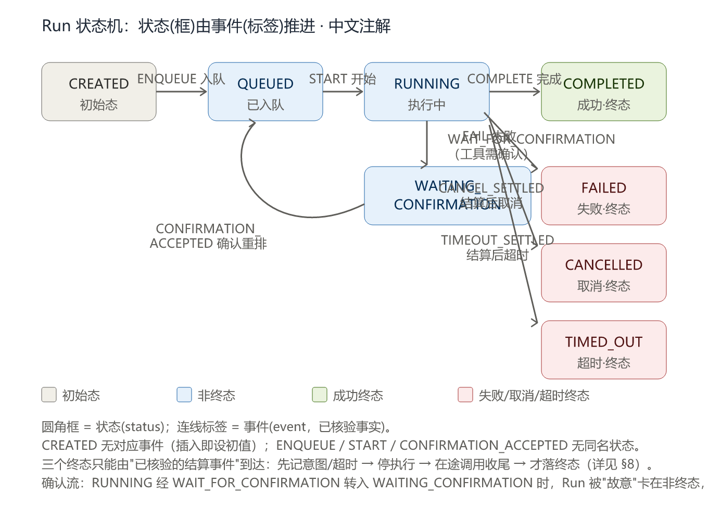
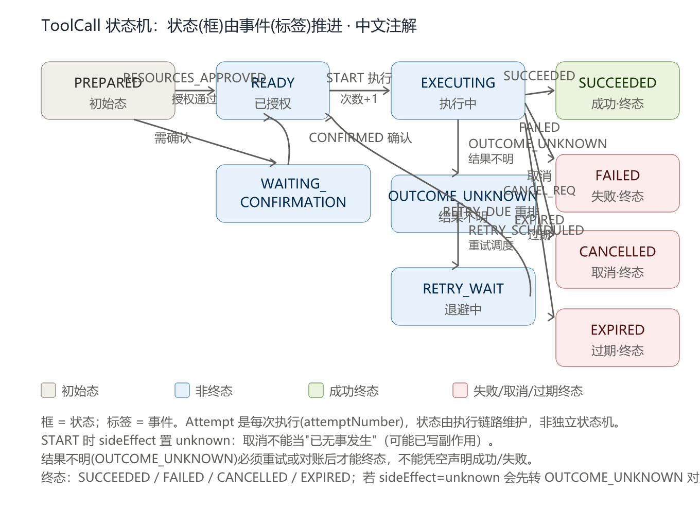
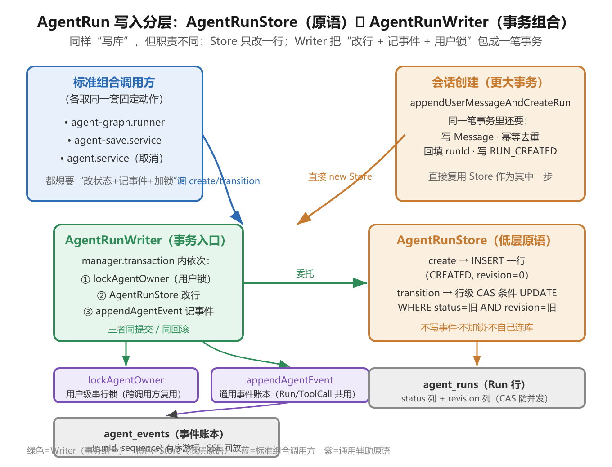
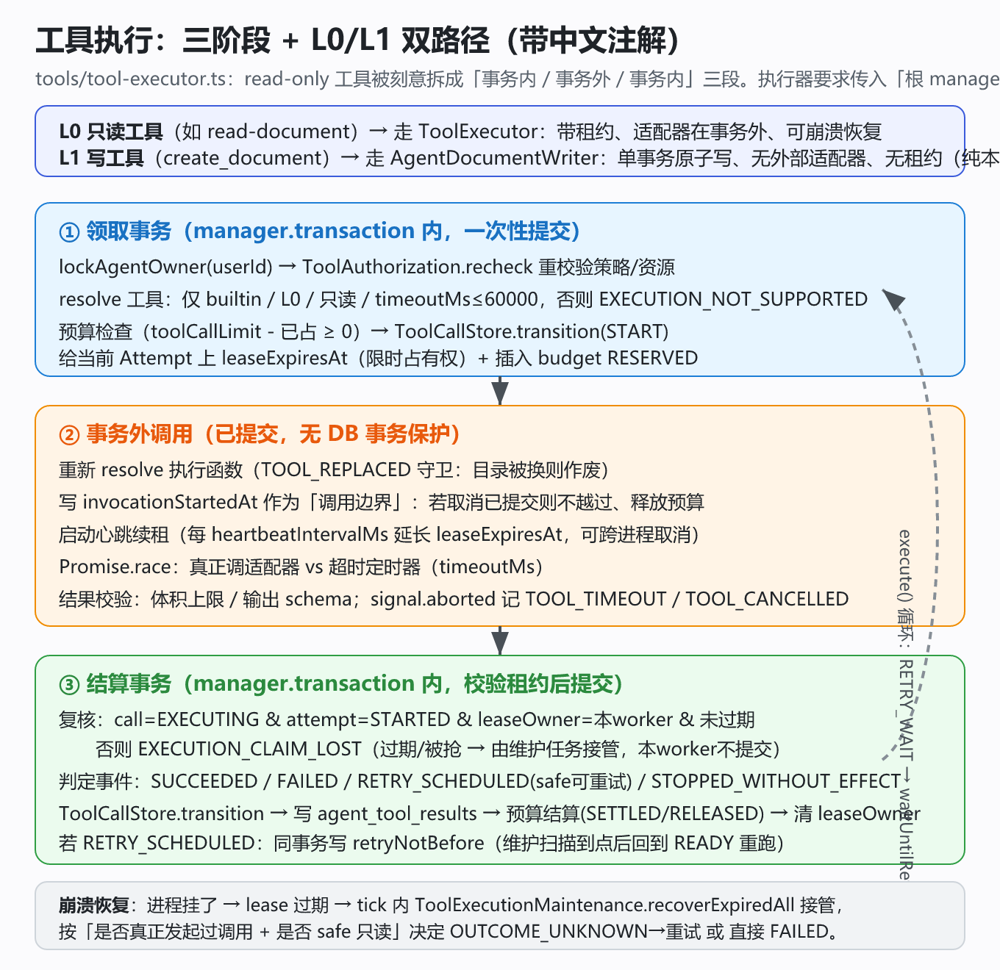

# Agent 模块阅读指南（唯一入口）

> **定位**：本文件是 Agent 模块的**唯一阅读入口**，已整合原《Agent新手阅读指南》《Agent模块阅读指南》《Agent模块统一阅读指南》《Agent核心逻辑与代码审阅指南》《Agent功能代码审核报告》及《§1.4 快照》。
> 「为什么这样设计」的知识点问答见 [`Agent知识问答.md`](./Agent知识问答.md)；求职面试框架见 [`AI-Agent前端-面试准备总览.md`](../../AI-Agent前端-面试准备总览.md)。
>
> 标注含义：★必读（理解全模块的地基）　●按需（改动到相关功能时再看）　○外围

## 目录

- [第零部分：前置心智（读前必看）](#第零部分前置心智读前必看)
- [第一部分：新手通读（先建立整体）](#第一部分新手通读先建立整体)
- [第二部分：9 阶段精读路线](#第二部分9-阶段精读路线)
- [第三部分：核心逻辑详解（为什么这样设计）](#第三部分核心逻辑详解为什么这样设计)
- [第四部分：第三遍代码地图（按四层定位文件）](#第四部分第三遍代码地图按四层定位文件)
- [第五部分：异常过滤器与 HTTP 状态码](#第五部分异常过滤器与-http-状态码)
- [附录](#附录)

---

# 第零部分：前置心智（读前必看）

## 0.1 一句话理解这个模块

> 它是一个"虚拟同事"后端：你给它一个话题或一份资料，它查资料、起草内容、把引用标清楚、必要时让你确认后再把成果写进你的文档库。

它的"麻烦"都来自一个事实：**一次请求可能跨很多次调度、多次工具调用、还可能中途崩溃**，所以必须靠"状态机 + 事务 + 锁 + 幂等"把这一切管住。你不需要一开始读懂每一行，目标是读完能画出"一条消息从浏览器到落库"的草图，并知道某问题该去哪个文件找。



## 0.2 名词表（先记住，别急着看代码）

| 名词 | 一句话 | 生活类比 |
| --- | --- | --- |
| **Thread** | 一段连续对话的容器 | 一个聊天窗口 |
| **Message** | 用户/助手可见消息；**用户消息触发一次 Run** | 窗口里的一条发言 |
| **Run** | 一次"生成 / 修订 / 保存"的业务生命周期 | 交给同事的一次具体任务 |
| **ToolCall / Attempt** | Run 内一次逻辑工具调用 / 它的某一次实际执行 | "查一次资料"这个动作 / 这次动作的第 1 次尝试 |
| **Source** | 本次 Run 观察到的引用片段（不是原文实时镜像） | 报告里标出的"出处" |
| **Artifact / ArtifactVersion** | 稳定成果及不可变版本（**不是** `documents` 文档表） | 草稿定稿 / 定稿的第 3 版 |
| **DocumentSave** | "要保存哪一版、存到哪个目录、预留哪个文档 ID"的绑定记录 | 待执行的"存盘指令" |
| **Confirmation** | 绑定"用户 + 调用 + 参数 + 资源版本"的批准记录 | 开工许可 |
| **Event** | Run 内有序的业务状态通知（不是模型 token 流） | 任务进度条上的节点 |
| **ModelCall** | 模型尝试记录 + 保守预算预占、实际用量观测 | 模型账单的每一条 |

**消息与 Run 是否一对一？** 每条**用户提交消息**（`role:'user'`、带 `requestKey`）经 `appendUserMessageAndCreateRun` 创建**恰好一个** Run（1:1）。**但**"消息"还包括**助手回复**（`role:'assistant'`、`runId` 非空、`requestKey` 为 null），一个 Run 可以有**多条**助手消息。准确说法："**每次提交 ⇄ 一个 Run（1:1）**"。

## 0.3 两条互相独立的状态机（别混）

- **Run 状态机**（`agent-run-lifecycle.ts`）：`CREATED → QUEUED → RUNNING → … → COMPLETED/FAILED/CANCELLED/TIMED_OUT`
- **ToolCall 状态机**（`tools/tool-call-lifecycle.ts`）：`PREPARED → READY/WAITING_CONFIRMATION → EXECUTING → … → 终态`





Run 结束了，不代表它里面的工具调用都结算完了；反过来也一样。两套都是**纯函数**（只判断"这次迁移合不合法"，不碰数据库），这是故意的——规则与 IO 分离，便于测试和审计。

**最直观的"反过来"例子**：需要用户确认的工具会把 ToolCall 停在 `WAITING_CONFIRMATION`，并顺势把 Run 降到 `WAITING_CONFIRMATION`（Graph 这一步 `return { status: 'paused' }` 挂起）。Run 不仅不是终态，而是被**刻意**卡在非终态，直到用户确认。所以"工具还没结算完，Run 不可能 COMPLETED"是设计上主动保证的。

## 0.4 按职责分四层（不要按"是不是跑批"分）

| 职责层 | 代表文件 | 是"跑批"吗 | 一句话 |
| --- | --- | --- | --- |
| **调度层** | `agent.service.ts:tick()` | 驱动者（只选不跑） | 后台每 ~2s 轮询，选出该跑的 Run（`SELECT` 候选），执行权交给下面 |
| **编排/执行层** | `agent-graph.ts`（蓝图）+ `agent-graph.runner.ts`（运行时） | ✅ 是 | `graph.ts` 只定义节点/边/状态/端口；`runner.run()` 持 advisory 锁、把 Run 推到 `RUNNING`、再 `invoke` 编译图真正跑"检索→模型→工具→成果" |
| **持久化层** | `agent-run.store/writer`、`agent-conversation.store`、`tools/tool-call.store`、`agent-event.*` 等 | ❌ 不是 | "落库原语"：store=原子改行、writer=事务组合（锁+改行+记事件）。被调度/编排及会话/保存/取消**复用**，自己不循环、不调度 |
| **工具/保存层** | `tools/tool-executor.ts`、`agent-save.service.ts`、`agent-document.writer.ts` | ❌（被跑批调用） | 真正调适配器/写文档，通过 graph 的"端口（ports）"被编排层调用 |

**真正"跑批"的链路**：`tick()` 选中候选 Run → `runner.run(run)` 执行 → 执行中经 `AgentRunWriter` 改状态、记事件。

## 0.5 最容易混淆的概念（读任何一遍都要回看）

| 你以为 | 实际含义（当前实现） |
| --- | --- |
| 目录里有工具 = 用户能用 | 仅表示"已装配"，是否有权调用还要过策略/资源/确认 |
| `prepared` = 可以执行了 | 只是参数和策略预检查通过，还没做资源授权/确认/领取 |
| `APPROVED` = 一定能执行 | 仍受有效期、绑定摘要、执行前复核约束 |
| `cancelRequested` = 已经停了 | 只是"取消意图"，执行可能还在收尾 |
| `executionPaused` = Run 失败了 | 只是"调度暂停"，不是终态 FAILED |
| Run 在 `WAITING_CONFIRMATION` = 卡住/失败 | 是在**等非终态**：某工具要用户确认，Graph 挂起，等 `decide` 后才继续 |
| 工具 lease 过期 = 该调用一定失败 | 不一定：维护任务会按"是否只读 safe"决定重试还是失败 |
| Checkpoint 存在 = 有结果了 | 只是"图恢复位置"，不是业务结果或授权 |
| Artifact draft = 已保存文档 | 只是草稿版本，写进 `documents` 才是保存 |
| Reader 查到的状态 = 同一时刻一致 | 多查询无统一事务，是"最终一致"，页面靠事件/心跳重读 |

## 0.6 读之前的四件事

1. **两条主线彼此独立**：Run 主线与 ToolCall 主线**不要合并理解**，Run 结束不代表调用已结算，反之亦然。
2. **锁顺序固定**：先用户锁（`agent-data.cleanup.ts` 的 `lockAgentOwner`），再 Run 行锁。所有写入入口都遵守，避免死锁。
3. **事务边界**：本地数据库写入在事务内完成；**模型调用、向量检索、工具适配器一律在事务外**。适配器的结果/结算再开一个事务提交。
4. **三类不可信数据**：模型输出、工具结果、文档正文，都只当数据处理，不拼 SQL、不 `eval`、不当指令。

---

# 第一部分：新手通读（先建立整体）

## 1.1 一次请求从浏览器到落库的完整旅程

```
浏览器 AgentPage 提交（requestKey 幂等键）
  → POST /agent/threads/:id/messages
  → AgentController → AgentService.submit()
      ├─ 按 mode/revisionTarget 选 workflowVersion
      └─ AgentConversationStore.appendUserMessageAndCreateRun()
            （用户消息 + 创建 Run + RUN_CREATED 事件，同一事务）
  → 每 2s tick() 选中候选 Run
  → AgentGraphRunner.run()（持 advisory lock）
      CREATED → QUEUED → RUNNING → graph.invoke()
          initialize → model →（tools → model 循环）→ answer
              → 分叉：finish / draft→publishDraft / 保存两阶段
  → 前端经 SSE /agent/runs/:id/stream 收事件，收到后拉快照刷新
```

## 1.2 第一遍阅读路线（把 9 阶段压成 4 块）

| 块 | 内容 | 对应阶段 |
| --- | --- | --- |
| **A 入口** | `agent.module` → `agent.controller` → `agent.service`（`tick`） | 阶段一 |
| **B 状态机** | 两套纯函数状态机 + 实体/迁移 | 阶段二 |
| **C 跑批** | 会话创建 → Store/Writer → graph 蓝图 → runner 运行时 | 阶段三 |
| **D 工具与保存** | 工具分层（Definition→Executor）+ 保存两阶段 | 阶段五、六 |

第一遍只求"知道谁调谁"，不追被调实现。被调实现留到第二/三遍各层深读。

## 1.3 新手只需记住三个"谁"

1. **谁把消息变成 Run？** `AgentConversationStore.appendUserMessageAndCreateRun`（消息+Run+事件同事务）。
2. **谁决定下一步跑什么？** `AgentService.tick()` 选候选，`AgentGraphRunner.run()` 真正执行。
3. **谁保证不重复、不越权、不丢事件？** `requestKey` 幂等 + 两套状态机 + 锁顺序 + 事件序号同事务。

---

# 第二部分：9 阶段精读路线

> 面向第一次接手本模块的人。按"骨架 → 数据 → 主链路 → 工具 → 保存 → 外围 → 前端"的顺序读，每一阶段结束都能回答一组具体问题，不需要回头补读。

## 阶段一：骨架（约 30 分钟）

| 顺序 | 文件 | 行数 | 看什么 |
| --- | --- | --- | --- |
| ★1 | `apps/server/src/modules/agent/agent.module.ts` | 34 | 模块装配了哪些 provider、依赖哪些外部模块（Auth / Ai / Search）、注册了哪些实体 |
| ★2 | `agent.controller.ts` | 166 | 全部 HTTP 与 SSE 路由；`AgentApiErrorFilter` 如何把内部错误码映射成 400/409 |
| ★3 | `agent.service.ts` | 232 | 应用入口：`onModuleInit` 起的**唯一轮询** `tick()`，每 2s 一轮，负责索引投递、工具维护、领取 10 个 Run 并分派 |

读完应能回答：一条用户消息进来后，谁把它变成 Run？谁决定下一步执行什么？

关键分派逻辑在 `agent.service.ts:146-172`：
- `cancelRequested` → `settleCancellation()`（等无在途调用后落终态）
- `workflowVersion === 'agent-save-v1'` → `AgentSaveService.execute()`
- 其余 → `AgentGraphRunner.run()`

## 阶段二：数据模型与状态机（约 45 分钟）

### 2.1 实体（只看字段与可空性，不看逻辑）

`apps/server/src/modules/agent/entity/`

| 文件 | 行 | 说明 |
| --- | --- | --- |
| ★`agent-run.entity.ts` | 83 | `agent_runs` 主表：`status / revision / executionPaused / cancelRequested / nextDispatchAt / toolCallLimit` |
| `agent-thread.entity.ts` | 27 | 会话容器 |
| `agent-message.entity.ts` | 38 | 只存用户可见内容；`requestKey + requestDigest` 是幂等基础 |
| ★`agent-tool-call.entity.ts` | 83 | 逻辑调用：`status / sideEffect / attemptCount / retryNotBefore / cancelRequested` |
| ★`agent-tool-attempt.entity.ts` | 43 | 每轮尝试：租约 `leaseOwner / leaseExpiresAt`、调用边界 `invocationStartedAt` |
| `agent-run-source.entity.ts` | 77 | Run 的来源快照与 `citationLabel` |
| `agent-artifact.entity.ts` / `agent-artifact-version.entity.ts` / `agent-artifact-source.entity.ts` | 22 / 56 / 26 | 成果头、版本、版本↔来源引用 |
| `agent-document-save.entity.ts` | 61 | 保存绑定：预留 `documentId`、`digest`、`status` |
| `agent-model-call.entity.ts` | 58 | 模型调用审计（不含提示词正文） |

### 2.2 迁移（按时间戳顺序，即真实演进顺序）

`apps/server/src/migrations/1789430400000-…` 起共 24 个，顺序本身就是设计史：

```
事件与运行 → 工具调用 → 尝试 → 确认 → 只读执行 → 崩溃恢复 → 重试调度
→ 会话消息 → Run 来源 → Checkpoint → 引用标签 → 模型审计 → 工具来源
→ 成果/修订区间/证据 → 文档保存/保存提交 → 模型预算 → 调度 → 存储与索引
```

读法：只扫 `up()` 的表结构与约束，**不要**跳过 CHECK 约束——很多业务规则（如"终态不得再变更"）落在数据库里。

### 2.3 两套状态机

| 顺序 | 文件 | 行 | 看什么 |
| --- | --- | --- | --- |
| ★4 | `agent-run-lifecycle.ts` | 66 | `transitionAgentRun()`：合法迁移表 + `isAgentRunTerminal()`；纯函数，不含 IO |
| ★5 | `tools/tool-call-lifecycle.ts` | 109 | `transitionToolCall()`：`RETRY_SCHEDULED / RETRY_DUE / OUTCOME_UNKNOWN / STOPPED_WITHOUT_EFFECT` 等事件的精确条件 |

读完应能回答：`sideEffect: 'unknown'` 为什么不能被取消清空？为什么 `OUTCOME_UNKNOWN` 不是终态？

## 阶段三：一次对话/任务的主链路（约 60 分钟）

按调用顺序读：

| 顺序 | 文件 | 行 | 职责 |
| --- | --- | --- | --- |
| ★6 | `agent-conversation.store.ts` | 227 | 用户消息 + 创建 Run + `RUN_CREATED` 事件**同事务**；`requestKey` 重放返回原记录 |
| ★7 | `agent-run.store.ts` | 112 | `agent_runs` 的内部读写入口，条件更新防并发 |
| ★8 | `agent-run.writer.ts` | 42 | 状态变更 + 事件序号 + 事件正文**全提交或全回滚** |
| ●9 | `agent-knowledge.service.ts` | 158 | 复用既有 RAG/混合检索选来源；候选最终仍按 `documents.userId + deletedAt` 复核 |
| ●10 | `agent-context.ts` | 195 | 上下文预算与裁剪、token 估算 |
| ●11 | `agent-model.config.ts` | 93 | 独立模型配置文件，密钥走环境变量 |
| ●12 | `agent-model.client.ts` | 220 | LangChain 适配器；`parseAgentModelDecision()` 解析工具调用 |
| ●13 | `agent-model-call.recorder.ts` | 72 | 调用审计：开始先提交 → 外部调用在事务外 → 结束记录 |
| ★14 | `agent-model-tools.ts` | 100 | 模型工具协议边界：只发布允许发现的定义，模型提出的调用不是许可 |
| ★15 | `agent-graph.ts` | 177 | LangGraph 编排：节点 `initialize / model / tools / generateOutline / publishOutline / draft / assembleSection / reviewEvidence / publishDraft / finish` |
| ★16 | `agent-graph.runner.ts` | 250 | 把业务端口（ports）接进 Graph：advisory lock、每次节点前 `guard()`、工具执行与来源捕获 |
| ○17 | `agent-checkpointer.ts` | 10 | PostgresSaver 适配，schema 固定 `agent_checkpoint`，禁止自动建表 |

`agent-graph.ts` 的读法：先看 `AgentGraphState`（第 16 行）与 `AgentGraphPorts`（第 33 行，全部业务能力都以端口注入），再看第 169-175 行的边，最后逐个节点。Graph 只负责"执行位置 + 编排"，**业务写入全部在端口里的事务入口**。

## 阶段四：成果、引用与修订（约 30 分钟）

| 顺序 | 文件 | 行 | 职责 |
| --- | --- | --- | --- |
| ★18 | `agent-source.store.ts` | 117 | Run 来源快照持久化与去重 |
| ★19 | `agent-citations.ts` | 29 | `validateAgentCitations()`：回答里的 `[S1]` 必须落在本 Run 来源表内 |
| ●20 | `agent-evidence.ts` | 60 | 证据问题契约；解析模型 JSON，结构合法 ≠ 事实正确 |
| ★21 | `agent-artifact.store.ts` | 118 | 成果版本发布（用户锁 → Run 锁 → 版本递增） |
| ●22 | `agent-artifact-revision.ts` | 33 | 修订前复核归属、版本冲突、旧来源访问权 |
| ●23 | `agent-revision-range.ts` | 40 | 局部修订的半开区间替换（UTF-16 偏移） |
| ●24 | `agent-section-context.ts` | 62 | 章节修订：历史引用按原标签继承，新来源从其后编号 |
| ●25 | `agent-tool-source.store.ts` | 65 | 已提交的 `read_document` 结果转可引用来源 |

## 阶段五：工具链路（最硬核，约 90 分钟）

严格按下表顺序读，前面是后面的前置概念：

| 顺序 | 文件 | 行 | 职责 |
| --- | --- | --- | --- |
| ★26 | `tools/tool-definition.ts` | 45 | 工具描述契约（含未来 MCP 的 `origin`） |
| ★27 | `tools/tool-definition-validator.ts` | 60 | 结构校验与稳定错误码；只校验，不注册 |
| ★28 | `tools/tool-catalog.ts` 与 `tool-catalog.test.ts` | 152 | **唯一装配目录**：结构校验 → Schema 编译 → 适配器匹配，全成功才发布；定义与函数同表存储 |
| ★29 | `tools/tool-policy.ts` | 93 | 调用前策略判断：身份、允许列表、风险等级、MCP 连接、权限 |
| ★30 | `tools/tool-call-preparer.ts` | 94 | 串联策略 + 目录解析 + 输入 Schema 校验，产出 `prepared` |
| ●31 | `tools/tool-schema-validator.ts` | 87 | Ajv 实现的 JSON Schema 2020-12 校验，注册时一次编译 |
| ★32 | `tools/tool-resources.ts` | 69 | 资源归属检查与 `bindingDigest()`（确认绑定的摘要基础） |
| ★33 | `tools/tool-authorization.ts` | 187 | 授权与确认事务：`authorize / decide / expire / expireDue / recheck` |
| ★34 | `tools/tool-call.store.ts` | 152 | 逻辑调用持久化与条件迁移；`transition()` 是状态落库的唯一入口 |
| ●35 | `tools/tool-attempt.writer.ts` | 43 | 尝试记录写入，仅由 ToolCallStore 调用 |
| ★36 | `tools/tool-executor.ts` | 277 | 受控只读执行：**领取事务（授权+预算+租约）→ 适配器在事务外 → 结算事务（结果+预算+迁移）** |
| ★37 | `tools/tool-retry.ts` | 112 | 与恢复侧共用的退避策略 `ToolRetryPolicy` 与 `advanceDueRetry()` |
| ★38 | `tools/tool-execution-registry.ts` | 45 | 进程内取消桥接（AbortController）；数据库 `cancelRequested` 才是持久事实 |
| ★39 | `tools/tool-execution-control.ts` | 175 | 取消、过期只读租约恢复、到期重试推进 |
| ★40 | `tools/tool-execution-maintenance.ts` | 50 | 单轮维护；**轮询由 `AgentService.tick()` 驱动**，本类不带定时器 |
| ●41 | `tools/read-document.tool.ts` | 30 | 唯一的真实只读工具：按归属读取并比对正文/位置版本 |
| ●42 | `tools/create-document.tool.ts` | 23 | 保存工具定义；真正写入在 `agent-document.writer.ts` |

读完应能回答：一次 `read_document` 从模型提议到结果入库，经过几道闸门？租约过期后谁接手？退避到期由谁推回 `READY`？

## 阶段六：保存链路（写路径，约 30 分钟）

| 顺序 | 文件 | 行 | 职责 |
| --- | --- | --- | --- |
| ★43 | `agent-save.service.ts` | 76 | `prepare()` 建 Run + 预留保存 + 请求确认；`execute()` 批准后原子提交 |
| ★44 | `agent-document-save.store.ts` | 119 | `prepare()` = 复核 + 预留文档 ID；`verify()` = 执行阶段**只读复核**（不写、不开事务） |
| ★45 | `agent-document.writer.ts` 与 `agent-document.writer.test.ts` | 103 | 文档创建 + Yjs 快照 + 同步记录 + 保存事实 + 调用结果 + 预算**同事务** |

读法重点：为什么 `verify()` 与 `prepare()` 要分开？（避免嵌套事务与重复预留）为什么 `insert` 而不是 `upsert`？（预留 ID 被占用时不能覆盖既有文档）

## 阶段七：事件、查询、调度与外围（约 25 分钟）

| 顺序 | 文件 | 行 | 职责 |
| --- | --- | --- | --- |
| ★46 | `agent-event.ts` | 92 | 持久化事件正文的解析与校验（区分于驱动状态迁移的领域事件） |
| ●47 | `agent-event.writer.ts` | 22 | 事务内事件写入，不独立提交 |
| ●48 | `agent-event.reader.ts` | 57 | 事件分页；SSE 断线补齐靠它 |
| ●49 | `agent-run.reader.ts` | 113 | 只读查询层：会话列表/明细、运行快照；行类型从实体投影 |
| ○50 | `agent-data.cleanup.ts` | 43 | `lockAgentOwner()`（用户锁）与账号清理；未结束 Run 阻止清理 |
| ○51 | `agent-data.exporter.ts` | 145 | 用户数据导出 |

## 阶段八：前端与 API 契约（约 20 分钟）

| 顺序 | 文件 | 行 | 职责 |
| --- | --- | --- | --- |
| ●52 | `packages/api/src/agent/agentApi.ts` | 126 | 前端唯一入口；类型与后端快照一一对应 |
| ●53 | `apps/web/src/pages/AgentPage.tsx` | 222 | 工作台界面：会话/运行选择、成果渲染、引用链接、确认与保存交互 |
| ○54 | `apps/web/src/styles/agent.css` | 29 | 样式 |

`AgentPage.tsx` 里两个值得先看的函数：`citedText()`（把 `[S1]` 渲染成来源链接，不用 `dangerouslySetInnerHTML`）与提交时的请求键复用逻辑（防重复操作）。

## 阶段九：测试地图（按需对照）

| 想验证什么 | 看哪个测试 |
| --- | --- |
| 状态机规则 | `agent-run-lifecycle.test.ts`、`tools/tool-call-lifecycle.test.ts` |
| 工具装配/策略 | `tools/tool-catalog.test.ts`、`tool-definition-validator.test.ts`、`tool-policy.test.ts` |
| 重试与到期推进 | `tools/tool-retry.test.ts`（离线）、`tools/tool-call.persistence.integration.test.ts`（真实事务竞争） |
| 保存完整链路 | `agent-v1.persistence.integration.test.ts` |
| 会话与 Run 持久化 | `agent-conversation.persistence.integration.test.ts`、`agent-runs.integration.test.ts` |
| 上下文/引用/证据/修订 | `agent-context.test.ts`、`agent-citations.test.ts`、`agent-evidence.test.ts`、`agent-revision-range.test.ts`、`agent-section-context.test.ts` |

集成测试统一开关：`RUN_INTEGRATION_TESTS=1`（`apps/server/scripts/run-integration-tests.mjs` 自动设置），前置 `docker compose -f docker-compose.test.yml up -d`。

---

# 第三部分：核心逻辑详解（为什么这样设计）

> 只讲"为什么"，不重复第二部分的"读哪些文件"。更细的知识点（NestJS / Node / 数据库 / 并发 / 设计模式 / TS / 网络协议）见 [`Agent知识问答.md`](./Agent知识问答.md)。

## 3.1 两套状态机 + 为什么要分开

Run 与 ToolCall 的终态条件、并发裁决都不同。合成一个就无法表达"Run 结束但工具还在结算"，也难测试。纯函数（不含 IO）让规则与数据库操作解耦，迁移表可单测。

## 3.2 为什么 `AgentRunStatus` 和 `AgentRunEvent` 要分开

状态是"当前是什么"，事件是"发生过什么"，两者生命周期不同：状态可被覆盖更新，事件只追加、有序号。混在一起会丢失审计轨迹。

## 3.3 事件序号同事务：`AgentRunStore` vs `AgentRunWriter`

- **Store 是低层"原子改行"原语**：`create`=INSERT，`transition`=带 CAS 的条件 UPDATE（`WHERE status=旧 AND revision=旧`），不写事件、不加锁、不自己开连接。
- **Writer 是"标准事务组合"**：在 `manager.transaction` 里串"用户锁 → Store 改行 → 记事件"，保证"状态⇄事件"原子。
- **不能合并的原因**：会话创建 `appendUserMessageAndCreateRun` 直接复用 Store 作为自己更大事务里的一步（还要写 Message、幂等去重、回填 runId）。



## 3.4 调度与跑批：`tick` / `graph.ts` 蓝图 / `runner` 运行时

- `tick()` 只**选**不跑（`SELECT` 候选，最多 10 个），串行 dispatch。
- `graph.ts` 只定义并编译图（节点/边/状态/端口），自身不执行。
- `runner.run()` 才是运行时：持 `pg_try_advisory_lock(userId:runId)`、推 `CREATED→QUEUED→RUNNING`、`invoke` 编译图。

## 3.5 Run 收尾的 `finish` 闸门

`runner` 的 `finish` 端口在 graph 到达 END 时回调，先做守卫（`status` 必须 `RUNNING`、`cancelRequested` 为假、无未结算 tool call 否则 `AGENT_GRAPH_CALLS_UNSETTLED`、引用标签与快照一致否则 `AGENT_CITATION_BINDING_CHANGED`），再在同一事务内 `appendAssistantMessage(role:'assistant')` + `transition(COMPLETE)` 原子提交。

## 3.6 工具执行双路径（L0 三阶段租约 / L1 原子写）

- **L0 只读**走 `ToolExecutor`：领取事务（授权复核→预算→租约）→ 事务外调适配器（心跳续租+超时竞速）→ 结算事务（CAS 校验→状态机终态→预算结算）。
- **L1 写工具 `create_document`** 不走 Executor，而是 `AgentSaveService.execute` 直接调 `AgentDocumentWriter.save`——单事务原子写（纯本地 SQL、无事务外适配器、无租约）。
- **为什么拆两个事务**：模型/适配器调用耗时数秒，放事务里会长期占连接、放大锁冲突。原则：**本地写在内、外部调在外、结果回来再开事务结算**。



## 3.7 保存：二次确认 + 单事务原子写

`prepare()` 只建 Run + 预留 documentId + 请求确认（停在 `WAITING_CONFIRMATION`，不写 `documents`）；用户 `decide` 批准后 `execute()` 才在同一事务内创建文档 + Yjs 快照 + 同步记录 + 保存事实 + 调用结果 + 预算。中途反悔不留半截文档。

## 3.8 成果、引用与修订

- 成果版本发布走"用户锁 → Run 锁 → 版本递增"。
- 引用校验 `validateAgentCitations()` 只保证标签语法/唯一/映射存在，**不证明语义支持**。
- 修订分整稿（提示词约束范围）与局部（`applyRevisionRange` 代码级 UTF-16 半开区间保护）。

## 3.9 SSE 事件流与读取

SSE 推的是**业务事件**（Run 状态变化、新消息、新成果），不是模型 token 流。前端用 `after` 序号断线续传，收到事件后拉完整快照刷新，因此订阅失败不影响最终一致性。

## 3.10 并发：锁层次 + 三类计数 + CAS

- **锁层次**：用户锁 → Run 行锁 → 调用行锁（固定顺序防死锁）。
- **三类计数**：`revision`（乐观锁）、`attemptCount`（重试次数）、`lastEventSequence`（事件序号）不要混用。
- **CAS**：所有状态迁移用 `UPDATE … WHERE status=旧 AND revision=旧`，并发冲突则失败重读。

---

# 第四部分：第三遍代码地图（按四层定位文件）

> 按四层分组。★必读（理解全模块的地基）　●按需（改动到相关功能时再看）　○外围。每个文件给「职责 / 重点行 / 盯什么」。这是阅读清单，不是逐行抄写。

## 3.1 入口层（装配 / HTTP / 调度）

| 文件 | 职责 | 盯什么 |
| --- | --- | --- |
| ★`agent.module.ts` | 模块装配：导入 Auth/Ai/Search、注册实体；Store/Writer/Runner 由调用方以 manager 构造，非每个都注册 provider | 哪些 provider、外部依赖 |
| ★`agent.controller.ts` | 全部 HTTP 与 SSE 路由；`AgentApiErrorFilter` 把内部码映射 400/409 | 路由清单、`INVALID_` 前缀→400、其余→409 |
| ★`agent.service.ts` | `onModuleInit` 起唯一轮询 `tick()`；`submit` 选工作流；取消/恢复分派 | `tick()` 四步真实顺序、降级门禁、dispatchIndexing、settleCancellation |

**HTTP 路由速记**：`POST /threads/:id/messages`(提交) · `POST /threads/:id/saves`(准备保存) · `POST /runs/:id/resume`(解暂停) · `POST /runs/:id/cancel` · `POST /runs/:id/confirmations/:id`(decide) · `GET /runs/:id/events` + `GET /runs/:id/stream`(SSE)。`userId` 取自 `req.user`，客户端不能选模型地址/权限/workflowVersion。

## 3.2 编排与执行层（graph / runner / 模型 / 知识）

| 文件 | 职责 | 盯什么 |
| --- | --- | --- |
| ★`agent-graph.ts` | LangGraph 蓝图：节点/边/`AgentGraphState`/`AgentGraphPorts`（业务全以端口注入） | 先看 `AgentGraphState`、`AgentGraphPorts`，再看边，最后逐节点；**业务写入全在端口事务入口** |
| ★`agent-graph.runner.ts` | 运行时：`run()` 持 advisory lock、`CREATED→QUEUED→RUNNING`、`invoke`、节点前 `guard()`、工具执行与来源捕获、`finish` 闸门 | `run()` 9 步；`finish` 守卫；图执行遇 `READY` 调用 `new ToolExecutor(...).execute(...)`（传未开事务的根 manager） |
| ○`agent-checkpointer.ts` | PostgresSaver 适配，复用 TypeORM pool；schema 固定 `agent_checkpoint`，禁自动建表 | 两道守卫：schema 白名单、版本自检精确比对 `[0..4]`；fail-fast + 稳定错误码 |
| ●`agent-knowledge.service.ts` | 复用 RAG/混合检索选来源；候选仍按 `documents.userId+deletedAt` 复核 | 两路失败降级、`documentUpdatedAt` 不保证 excerpt 最新 |
| ●`agent-context.ts` | 上下文预算与裁剪、token 估算（启发式，非计费） | Unicode code point 裁剪、来源/历史额度分配 |
| ●`agent-model.config.ts` | 独立模型配置，密钥走环境变量 | 不读取/复制密钥 |
| ●`agent-model.client.ts` | LangChain 适配器；`parseAgentModelDecision()` 解析工具调用 | `maxRetries=0`、`parallel_tool_calls=false`、工具描述只发名称/描述/Schema |
| ●`agent-model-call.recorder.ts` | 模型审计：先提交 STARTED、事务外调用、结束记录；用量 nullable，未知不冒充零费用 | 禁止携带活跃外层事务调模型 |
| ★`agent-model-tools.ts` | 模型工具协议边界：只发布允许发现的定义，模型提议 ≠ 许可 | 最多 8 工具提议 |

**节点路线（心智锚点）**：`START→initialize→model`，`model` 后 `tool_calls→tools→model`（循环）或 `answer`；`answer` 后按 `dialogue/新任务/整稿修订/局部修订` 分叉到 `finish` 或 `draft→publishDraft`。`tools` 节点**串行**执行（单步最多 8 个）。

## 3.3 持久化层（store / writer / reader / event）

| 文件 | 职责 | 盯什么 |
| --- | --- | --- |
| ★`agent-conversation.store.ts` | 用户消息 + 创建 Run + `RUN_CREATED` 同事务；`requestKey` 重放返回原记录；`appendAssistantMessage` | `appendUserMessageAndCreateRun` 9 步、幂等冲突 `AGENT_REQUEST_KEY_CONFLICT`、撤销后不解除错误暂停 |
| ★`agent-run.store.ts` | `agent_runs` 内部读写；条件更新防并发 | `create`(INSERT) / `transition`(CAS UPDATE) |
| ★`agent-run.writer.ts` | 状态 + 事件序号 + 事件正文全提交或全回滚 | 每方法开事务串 `lockAgentOwner→Store→appendAgentEvent` |
| ★`agent-run-lifecycle.ts` | Run 状态机纯函数 | `transitionAgentRun` / `isAgentRunTerminal` |
| ●`agent-run.reader.ts` | 只读聚合（列表/明细/快照） | 多查询无统一事务、最终一致、不推进状态 |
| ●`agent-event.ts` / `agent-event.writer.ts` / `agent-event.reader.ts` | 事件正文解析校验 / 事务内写序号 / 分页补齐 | `appendAgentEvent` 要求活跃事务；`sequence>after` 分页 |
| ○`agent-data.cleanup.ts` | `lockAgentOwner()`（用户锁）与账号清理；未结束 Run 阻止清理 | 用户锁是锁层次起点 |

## 3.4 工具与保存层

| 文件 | 职责 | 盯什么 |
| --- | --- | --- |
| ★`tools/tool-definition.ts` | 工具描述契约（含未来 MCP 的 `origin`） | 只描述，不含执行 |
| ★`tools/tool-definition-validator.ts` | 结构校验与稳定错误码；只校验不注册 | 不缓存结果 |
| ★`tools/tool-catalog.ts` | **唯一装配目录**：结构校验→Schema 编译→适配器匹配，全成功才发布 | 定义与函数同表存储；撤销不收回已取得函数引用（执行前必须重 `resolve`） |
| ★`tools/tool-policy.ts` | 调用前策略：身份/白名单/风险/MCP/权限 | 不负责具体资源与确认 |
| ★`tools/tool-call-preparer.ts` | Policy→resolve→输入副本 Schema 校验，产出 `prepared` | `prepared` 只是预检查通过 |
| ●`tools/tool-schema-validator.ts` | Ajv 2020-12 严格编译，注册时一次 | 不负责资源/预算 |
| ★`tools/tool-resources.ts` | 资源归属检查与 `bindingDigest()`（确认绑定摘要基础，SHA-256，非凭据） | scope 不隐式扩展 folder 后代 |
| ★`tools/tool-authorization.ts` | 授权与确认事务：`authorize/decide/expire/expireDue/recheck` | `authorize` PREPARED→READY 或 WAITING_CONFIRMATION（PENDING 默认 5 分钟）；`recheck` 要求 READY/未取消/RUNNING |
| ★`tools/tool-call.store.ts` | 逻辑调用持久化与条件迁移；`transition()` 是落库唯一入口 | `create`（用 `save:saveId` 逻辑键）/ `getAttempt` |
| ●`tools/tool-attempt.writer.ts` | 尝试记录写入，仅由 ToolCallStore 调用 | — |
| ★`tools/tool-executor.ts` | **L0 只读受控执行**：领取事务→事务外适配器→结算事务 | `EXECUTION_REQUIRES_ROOT_MANAGER`；租约/心跳/超时；重放只认 `builtin_read` |
| ★`tools/tool-retry.ts` | 与恢复侧共用的退避 `ToolRetryPolicy`/`advanceDueRetry` | 默认最多 3 次、基数 250ms、上限 5000ms；用 `clock_timestamp` 裁决到期 |
| ★`tools/tool-execution-registry.ts` | 进程内取消桥接（AbortController）；**跨进程取消依赖数据库 `cancelRequested`** | 不是持久化状态 |
| ★`tools/tool-execution-control.ts` | 取消、过期只读租约恢复、到期重试推进 | `recoverExpired` 只处理 RESERVED+builtin_read+STARTED+过期 |
| ★`tools/tool-execution-maintenance.ts` | 单轮维护；**轮询由 `tick()` 驱动，本类不带定时器** | `recoverExpiredAll` / `advanceDueRetries` / `expireDue` |
| ●`tools/read-document.tool.ts` | 唯一真实只读工具：按归属读取并比对正文/位置版本 | 10s 超时、256KiB 上限、safe 重试 |
| ●`tools/create-document.tool.ts` | 保存工具定义；真正写入在 `agent-document.writer.ts` | 通用 execute 故意报错，不能接进只读 Executor |
| ★`agent-save.service.ts` | `prepare()` 建 Run+预留保存+请求确认；`execute()` 批准后原子提交 | 分两阶段、`requestKey` 幂等 |
| ★`agent-document-save.store.ts` | `prepare()`=复核+预留文档 ID；`verify()`=执行阶段只读复核（不写、不开事务） | 两方法分开是为避免嵌套事务/重复预留 |
| ★`agent-document.writer.ts` | 文档创建 + Yjs 快照 + 同步记录 + 保存事实 + 调用结果 + 预算同事务 | `INSERT` 非 `upsert`；`sideEffect=committed`；无事务外适配器 |

**工具分层职责（防混淆）**：Definition/Validator（描述合法）→ SchemaValidator（参数/结果）→ Catalog（装配发布）→ Policy（策略）→ Preparer（输入准备）→ Store（快照/去重/状态）→ Authorization（授权/确认）→ Executor（L0 只读执行）→ DocumentWriter（L1 写原子）。

**Run 取消顺序**：`cancel` 先锁用户写 `cancelRequested=true` 并解除暂停 → 逐调用 `ToolExecutionControl.cancel`（执行前直接 CANCELLED，执行中只记意图并通知本进程）→ `tick` 优先 `settleCancellation` 检查无在途调用后 Run `CANCELLED`。不删除已发布成果、不回滚已保存文档。

## 3.5 成果 / 引用 / 修订层

| 文件 | 职责 | 盯什么 |
| --- | --- | --- |
| ★`agent-source.store.ts` | Run 来源快照持久化与去重 | 候选 ≠ 已进入上下文 ≠ 最终引用 |
| ★`agent-citations.ts` | `validateAgentCitations()`：标签语法/唯一/映射存在 | 不证明语义支持 |
| ●`agent-evidence.ts` | 证据问题契约；解析模型 JSON，结构合法 ≠ 事实正确 | 最多 20 项、整体 ≤64KiB、`null` 与"已分析但空"须区分展示 |
| ★`agent-artifact.store.ts` | 成果版本发布（用户锁→Run 锁→版本递增） | digest 重放、Thread 成果最多 20 |
| ●`agent-artifact-revision.ts` | 修订前复核归属、版本冲突、旧来源访问权 | 其他 Run 发新版本则冲突 |
| ●`agent-revision-range.ts` | 局部修订 UTF-16 半开区间替换 | `validateRevisionRange` 拒越界/切开代理对/CRLF/引用标签 |
| ●`agent-section-context.ts` | 章节修订：历史引用按原标签继承，新来源接其后 | 历史片段不是最新原文保证 |
| ●`agent-tool-source.store.ts` | 已提交 `read_document` 结果转可引用来源 | 按 callId 幂等、最多 20 标签、正文先限 6000 字符再裁 1500 Token |

## 3.6 外围（清理 / 导出）

| 文件 | 职责 | 盯什么 |
| --- | --- | --- |
| ○`agent-data.cleanup.ts` | 用户清理事务中先锁用户，未结束 Run 阻止清理；删除 Run/Thread 外键级联 | 与持久化层 `lockAgentOwner` 同源 |
| ○`agent-data.exporter.ts` | Agent 数据在 REPEATABLE READ 导出，按 userId 过滤 | Checkpoint blob 转 base64，不反序列化对象 |

## 3.7 实体清单（11 个，在 `entity/` 下）

`agent-run` · `agent-thread` · `agent-message` · `agent-tool-call` · `agent-tool-attempt` · `agent-run-source` · `agent-artifact` · `agent-artifact-version` · `agent-artifact-source` · `agent-document-save` · `agent-model-call`。

**重点字段**：Run 的 `status/revision/executionPaused/cancelRequested/nextDispatchAt/toolCallLimit`；ToolCall 的 `status/sideEffect/attemptCount/retryNotBefore/cancelRequested`；ToolAttempt 的 `leaseOwner/leaseExpiresAt/invocationStartedAt`。

## 3.8 迁移索引（24 个，当"演进索引"看即可）

`synchronize:false`，迁移建 schema；实体约束与迁移 CHECK 一致。顺序即设计史：

```
事件与运行 → 工具调用 → 尝试 → 确认 → 只读执行 → 崩溃恢复 → 重试调度
→ 会话消息 → Run 来源 → Checkpoint → 引用标签 → 模型审计 → 工具来源
→ 成果/修订区间/证据 → 文档保存/保存提交 → 模型预算 → 调度 → 存储与索引
```

**不必逐行读**：很多业务规则（如"终态不得再变更"）落在数据库 CHECK 里，扫 `up()` 的表结构与约束即可。

---

# 第五部分：异常过滤器与 HTTP 状态码

## 5.1 全局异常过滤器与 ArgumentsHost

**代码**（`agent.controller.ts` 顶部的 `AgentApiErrorFilter`）

```typescript
@Catch()
export class AgentApiErrorFilter implements ExceptionFilter {
  catch(error: unknown, host: ArgumentsHost): void {
    const response = host.switchToHttp().getResponse<Response>();
    if (response.headersSent) { response.end(); return; }
    if (error instanceof HttpException) { response.status(error.getStatus()).json(error.getResponse()); return; }
    const code = error instanceof Error && /^[A-Z][A-Z0-9_]{1,63}$/.test(error.message) ? error.message : 'AGENT_REQUEST_FAILED';
    response.status(code.startsWith('INVALID_') ? 400 : 409).json({ message: code });
  }
}
```

**解析**

- **`ArgumentsHost` 是什么**：NestJS 对"一次调用收到的所有参数"的**抽象包装**，让同一段逻辑能跨传输协议复用。提供 `getArgs()`、`getArgByIndex(i)`、`getContext()`，以及按协议切换的 `switchToHttp()` / `switchToRpc()` / `switchToWs()`。
- **`host.switchToHttp()` 做什么**：把抽象参数窄化到 **HTTP 上下文**，返回 `HttpArgumentsHost`，从而拿到 `getRequest()` / `getResponse()` / `getNext()`。过滤器要往 HTTP 响应写状态码和 JSON，必须先切到 HTTP 上下文取出 `response`。
- **为什么用 host 而不是直接拿 req/res**：`ExceptionFilter` 是**传输无关**的接口（同一个过滤器可同时用于 HTTP 控制器和 WebSocket 网关）。`@Catch()` 不传参数 = 捕获所有异常，是全局兜底过滤器。
- **与 `ExecutionContext` 的关系**：守卫/拦截器里的 `ExecutionContext` **继承** `ArgumentsHost`，并额外提供 `getClass()` / `getHandler()`。

## 5.2 HTTP 状态码语义：为何 `INVALID_*` 归 400、其余归 409

本过滤器把"输入错"与"状态冲突"分开，便于前端决定是"改参数"还是"重发"：

- **400 Bad Request（客户端输入非法）**：用于 `INVALID_*` 前缀——语义是"你传的参数/格式不对"。前端应引导用户改输入，而非盲目重发。
- **409 Conflict（状态/冲突不一致）**：用于其余稳定码（如 `AGENT_REQUEST_KEY_CONFLICT`、`AGENT_ARTIFACT_VERSION_CONFLICT`）——语义是"请求本身合法，但当前资源状态不允许"。前端应"换幂等键重发 / 先刷新状态 / 提示当前不可操作"。

**常见状态码与场景**

| 码 | 含义 | 典型场景 |
| --- | --- | --- |
| 200 | OK | 常规成功响应 |
| 201 | Created | 资源创建成功（如 `createThread`） |
| 400 | Bad Request | 参数校验失败（`INVALID_*`） |
| 401 | Unauthorized | 未登录/鉴权失败（`AuthGuard` 抛） |
| 403 | Forbidden | 已登录但无权限（如越权订阅他人 Run） |
| 404 | Not Found | 资源不存在（`HttpException` 透传） |
| 409 | Conflict | 状态冲突 / 版本冲突 / 幂等键重复 |
| 422 | Unprocessable Entity | 语义校验失败（格式对但不满足业务约束） |
| 429 | Too Many Requests | 限流（如 SSE 每用户 4 条超额 `AGENT_STREAM_LIMIT`） |
| 500 | Internal Server Error | 未预期服务端异常 |
| 502 / 503 | 网关 / 服务不可用 | 上游（模型/检索）挂了 |

**延伸（SSE 场景）**：流式响应一旦 `response.headersSent`（首字节已发），就不能再写状态码/JSON，只能 `response.end()` 中断连接——这是过滤器 `if (response.headersSent) { response.end(); return; }` 的由来。

---

# 附录

## A. 词汇表

- **Run / ToolCall / Attempt**：一次任务 / 任务里的一次逻辑工具调用 / 这次调用的某一次实际执行（一次调用可能重试多次 → 多个 Attempt）。
- **Source**：本次 Run 观察到的引用片段，不是原文实时镜像。
- **Artifact / ArtifactVersion**：稳定成果及其不可变版本（不是 `documents` 文档表）。
- **DocumentSave**："要保存哪一版、存到哪个目录、预留哪个文档 ID"的绑定记录。
- **Confirmation**：绑定"用户 + 调用 + 参数 + 资源版本"的批准记录。
- **Event**：Run 内有序的业务状态通知（不是模型 token 流）。
- **ModelCall**：模型尝试记录 + 保守预算预占、实际用量观测。
- **advisory lock（咨询锁）**：Postgres 的应用层锁，`pg_try_advisory_lock`，用于"同一 Run 同一时刻只被一个进程跑"。
- **租约 lease**：工具执行时给 Attempt 上的"限时占有权"，过期由维护任务接管，防止崩溃后无人收尾。
- **幂等 idempotent**：同一操作执行一次和多次结果一致；本模块靠 `requestKey`、逻辑调用键、唯一约束实现。
- **CAS（compare-and-swap）**：状态更新时"旧值匹配才改"，`UPDATE … WHERE status=旧 AND revision=旧`，避免并发覆盖。
- **Checkpoint**：LangGraph 记录"图执行到哪"的位置，断点续跑用。
- **SSE**：Server-Sent Events，服务端向浏览器单向推事件流，前端用它实时刷新。

## B. 速查：常见问题从哪个文件入手

| 问题 | 入口 |
| --- | --- |
| 用户消息怎么变成一次运行？ | `agent-conversation.store.ts` → `agent.service.ts:submit()` |
| 为什么 Run 卡在等待确认？ | `tools/tool-authorization.ts`（`authorize / decide / expire`） |
| 工具为什么没执行/一直重试？ | `tools/tool-executor.ts` → `tool-retry.ts` → `tool-execution-control.ts` |
| 进程崩了，在途调用谁收尾？ | `tool-execution-control.ts:recoverExpired()`、维护单轮 `tool-execution-maintenance.ts` |
| 取消为什么不是立刻生效？ | `tool-execution-registry.ts`（本进程信号）+ 数据库 `cancelRequested`（持久事实） |
| 保存为什么需要二次确认？ | `agent-save.service.ts` → `agent-document.writer.ts` |
| 引用 `[S1]` 怎么变成链接？ | 后端 `agent-citations.ts` → 前端 `AgentPage.tsx:citedText()` |
| 想加一个新工具 | `tool-definition.ts` → 在 `agent.service.ts:assembleV1Tools()` 装配 → 适配器实现 |

## C. 阅读时的 5 条提醒

1. **授权结果不可缓存**：`ToolPolicy.evaluate()` 与 `ToolAuthorization.recheck()` 都是即时判断，策略/目录变更必须立刻生效。
2. **目录撤销不收回已取得的函数引用**：执行前必须重新 `resolve()` 并比对，见 `tool-executor.ts` 的 `TOOL_REPLACED`。
3. **适配器只接受 JSON 边界**：参数与结果都经 `structuredClone`/JSON 序列化，不传函数或类实例。
4. **v1 只装配内置工具**：`AgentService.assembleV1Tools()` 装配后校验 origin 必须 `builtin`；MCP 的类型与策略接口保留，但暂不接入核心路径。
5. **不要为了省事合并**：生命周期模型、事务边界、实体、迁移、测试各自独立是有意为之，机械合并会破坏可回滚性。

## D. 审阅时应主动挑战的边界

这些是代码现状/审阅关注点，不代表已修复或判定为缺陷。

- [ ] `status.ready` 只检查哨兵列；部署是否有完整迁移门禁？
- [ ] `tick` 串行处理最多 10 个候选，慢模型会拖延其他任务；当前吞吐是否符合目标？
- [ ] Graph 持有独立连接的会话锁，连接池容量是否容纳业务、模型等待和 Checkpoint？
- [ ] 原子业务事务与 Checkpoint 非原子，是否接受模型重复调用的费用语义？
- [ ] 新任务已有一次 answer 后还生成 outline/draft/evidence，最低调用预算是否充分？
- [ ] 模型关闭时保存可执行、索引暂不投递，这是否符合产品预期？
- [ ] 取消在途模型不是实时中断；UI 是否仅显示"正在取消"而不声称已停止？
- [ ] 待确认保存会被 tick 尝试并可能因未批准暂停，批准后 resume 才恢复；该状态展示是否容易误导用户？
- [ ] Reader 多查询最终一致，事件没有覆盖全部成果/调度字段，页面需要心跳重读。
- [ ] shared 允许表达媒体类型不等于 Agent 已有媒体处理能力；当前消息入口仍仅 text。
- [ ] API 客户端的部分 view 比服务端 Entity 更窄（如 message.runId nullable 差异），兼容旧记录时需对照。
- [ ] 检索片段新鲜度与引用语义真实性没有被结构校验解决。
- [ ] 整稿修订依靠提示词约束改动范围；局部修订才有代码级范围保护。
- [ ] `extractAgentModelText` 会 trim 文本，局部 replacement 的首尾换行不保证保留。
- [ ] `create_document` 的通用 execute 故意报错，不能在重构时把它接入只读 Executor。
- [ ] 模型失败留 STARTED 或暂停记录时，不得把 null 用量当零费用。
- [ ] 同一成果版本只绑定一次保存：拒绝/过期后改键重存的产品体验需专门审阅。
- [ ] Run `TIMED_OUT` 作为领域状态存在，不等于系统已实现任意全局 Run 超时任务。
- [ ] MCP 仅留契约；Graph/Executor 还有 builtin 限制，不能只增加一个 adapter 就宣称接入完成。
- [ ] 全仓 lint 和真实 Agent 浏览器交互/供应商调用不在已通过的集成证据里。

## E. 功能代码审核发现（2026-10-03）

> 审核分支 `agent-review`，结论：**架构扎实、可合并质量高**。核心控制在并发安全、事务边界、幂等、崩溃恢复、权限确认、不可信数据隔离等高风险维度都有显式设计与兜底，无数据损坏、越权或 XSS 类严重缺陷。

**设计亮点（已确认正确）**

1. 两套独立状态机，纯函数、终态保护。
2. 锁顺序固定（用户锁 → Run 行锁 → 调用行锁）。
3. 事务边界正确（外部调用在事务外）。
4. 幂等基线（`requestKey + requestDigest`、唯一索引）。
5. 事件序号原子性（CTE 单事务）。
6. 三阶段工具执行（fail-closed）。
7. 权限确认不可缓存（每次 `recheck`）。
8. 保存原子写（`INSERT` 非 `upsert`）。
9. 前端安全（`citedText` 不用 `dangerouslySetInnerHTML`）。

**发现的问题（按严重度）**

| 级别 | 问题 | 状态 |
| --- | --- | --- |
| 🟢 低危 | 并发幂等未完全兜底（`appendUserMessageAndCreateRun` 并发同键触发 23505 未优雅回退） | **已修复**：捕获 `23505`（`UQ_agent_messages_request`）后 `replayExistingRequest` 返回既有记录 |
| 🟠 运营风险 | 连接池与 advisory 锁在长模型调用期间占用（`agent.service.ts:162-193` + `runner.ts:75-81,240`） | 建议监控 `pg_stat_activity`、上调 `pool.size` |
| 🟠 运营风险 | 模型持续失败时无自动 FAILED（无限重试且持续产生费用） | 建议连续失败计数/断路器 |
| 🟡 已知限制 | `extractAgentModelText` 的 `trim()` 可能剥离局部修订首尾换行 | QA 针对章节修订做排版回归 |
| ⚪ 轻微 | `submit()` 对新建 Run 的 `executionPaused=false` 更新冗余 | 无功能影响，可保留作防御 |
| ⚪ 设计确认 | "待确认保存被 tick 尝试并可能暂停"是预期行为 | 非 bug；UI 用 `lastErrorCode` 提示"已暂停" |

**验证建议**：本地起 Docker 后跑单测（`pnpm --filter server test`，预期 ~228 项）与集成（`RUN_INTEGRATION_TESTS=1`，预期 23 通过）；重点看 `agent-v1.persistence.integration.test.ts` 与 `tool-call.persistence.integration.test.ts`。

## F. 上手练习（挑一个做，比通读更有效）

1. **想加一个新的只读工具**：从 `tools/tool-definition.ts`（描述契约）→ 在 `agent.service.ts:assembleV1Tools()` 装配 → 实现适配器。注意 v1 只接 `builtin` 工具。
2. **想看并发幂等怎么测**：读 `agent-conversation.persistence.integration.test.ts` 里"两个并发同 `requestKey` 提交"的用例（断言 `a.run.id === b.run.id` 且恰有一个 `replayed`）。
3. **想看状态机规则**：读 `agent-run-lifecycle.test.ts` 与 `tools/tool-call-lifecycle.test.ts`，看枚举终态与非法迁移。

## G. 几个"为什么这么设计"的问答

**Q：为什么要两套状态机，不合成一个？**
A：Run 和 ToolCall 的生命周期、终态条件、并发裁决都不同。合成一个会让"Run 结束但工具还在结算"这类情况无法表达，也难测试。

**Q：为什么模型/工具调用要在事务外？**
A：外部调用可能耗时数秒。若放在数据库事务里，会长期占用连接、放大锁冲突。原则：**本地写在内、外部调在外、结果回来再开事务结算**。

**Q：为什么锁顺序要固定（用户锁 → Run 锁 → 调用锁）？**
A：所有写入入口都按同一顺序拿锁，才能从根本上避免死锁。

**Q：保存为什么需要二次确认？**
A：写文档是"对用户的真实资料动手"，所以先 `prepare`（只预留、不写 documents），等用户在 UI 批准后再 `execute`（原子提交）。中途反悔也不会留下半截文档。

**Q：取消 / 超时为什么不是立刻生效？**
A：Run 的终态要求"执行已停、在途调用已处理"，而取消/超时触发时往往还有正在跑的工具调用（可能已产生副作用）。所以流程是"先记意图、再停执行、最后才落终态"。

**Q：正常工具调完把 Run 置为 COMPLETED，但有的工具要用户确认，这时 Run 是非终态吗？**
A：是，而且是**刻意设计**的。需要确认的工具会把 Run 从 `RUNNING` 降到 `WAITING_CONFIRMATION`，Graph `return { status: 'paused' }` 暂停，等用户 `decide` 后 `resume` 才继续。

**Q：AgentRunWriter 和 AgentRunStore 为什么不合并成一个"写库"类？**
A：Store 是低层"原子改行"原语（INSERT / CAS UPDATE），不写事件、不加锁；Writer 是"标准事务组合"（锁 + 改行 + 记事件）。会话创建直接复用 Store 作为更大事务里的一步，所以分层是为了让 Store 既能被大事务复用、又能被 Writer 标准封装。

## H. 前端层速览

| 主题 | 要点 |
| --- | --- |
| 页面挂载 | `App.tsx:59` `/ai → AgentPage`，在 `AuthRoute` 保护内 |
| API 层 | `packages/api/src/agent/agentApi.ts`：全部接口 + 类型 + SSE `stream()` |
| SSE 机制 | `adapter:'xhr'` + `onDownloadProgress` 增量解析；`\n\n` 切帧；`after` 序号断线续传；`sequence>last` 幂等去重 |
| 三栏状态 | 左 `threads` / 中 `messages`+`runs` / 右 `detail`；写操作走 `act()` 串行锁 |
| 幂等键 | `keyFor()`：参数签名不变复用 `requestKey`，变了换 UUID |
| 引用安全 | `citedText()` 正则切 `[S1]`，只对服务端校验过的来源建 `<Link>`，不用 `dangerouslySetInnerHTML` |
| 两阶段保存 | 前端 `save()` → `prepare` 预览 → 确认卡片 `decide()` → `execute` 原子提交 |
| 详细内容 | 见 [`Agent知识问答.md`](./Agent知识问答.md) 的「七、前端层」章节 |

## I. 相关文档

| 文档 | 用途 |
| --- | --- |
| [`Agent知识问答.md`](./Agent知识问答.md) | 按知识点组织的「为什么」级问答（NestJS / Node / 数据库 / 并发 / 设计模式 / TS / 网络协议 / 前端） |
| [`AI-Agent前端-面试准备总览.md`](../../AI-Agent前端-面试准备总览.md) | 求职面试知识域总框架 |
| [`docs/架构.md`](./架构.md) | 模块职责与依赖边界 |
| [`docs/Issue.md`](./Issue.md) | 已验证问题根因与修复记录 |
| [`docs/技术笔记.md`](./技术笔记.md) | 技术原理深度笔记 |
